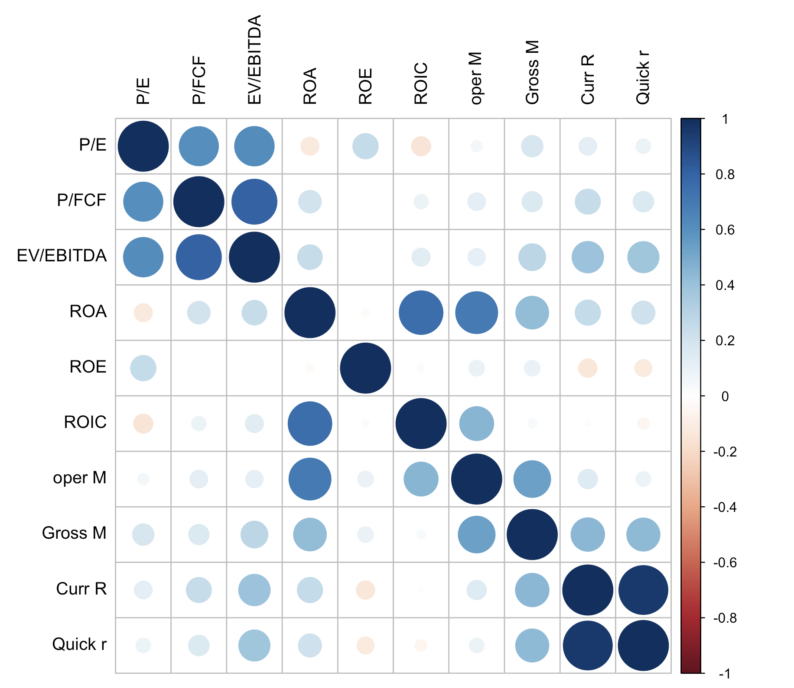
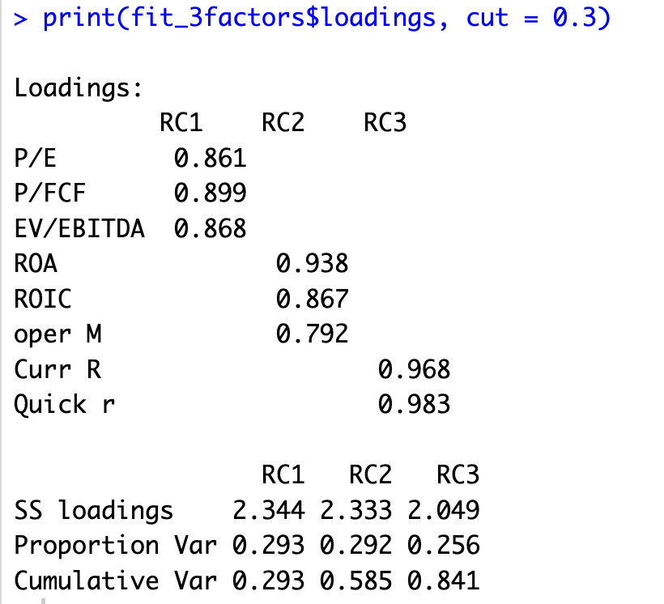
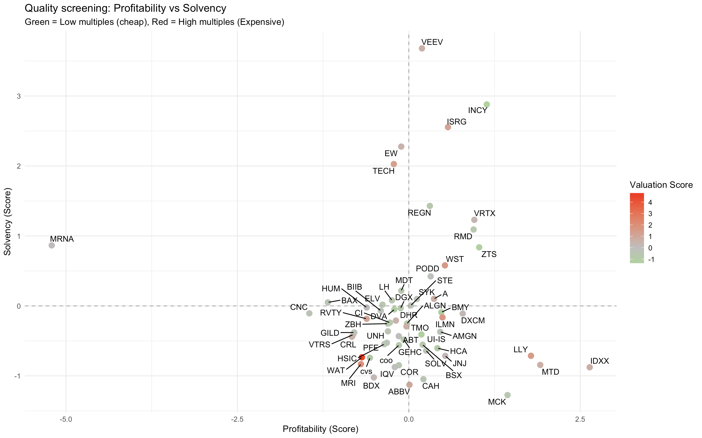

# Finding Cheap Quality Stocks with PCA

> *"Everyone says the market is too expensive. Is it still possible to find cheap stocks without compromising on quality?"*

This project tries to answer that question with a quantitative approach: instead of looking at valuation multiples in isolation, we use **Principal Component Analysis (PCA)** to compress a large set of balance sheet indicators into a few interpretable scores, then screen for companies that are **cheap, profitable and solvent at the same time**.

The analysis is applied to the **healthcare companies of the S&P 500**, using balance sheet indicators and valuation multiples for each company (`HEALTHCARE_PCA.xlsx`).

The full code is in [`PCA_refined.R`](PCA_refined.R).

---

## 1. Data preparation

- Each **row** is a healthcare company in the S&P 500.
- Each **column** is a financial indicator (valuation multiples, margins, liquidity ratios, ...).
- Missing values are replaced with the **mean of the respective column**, so no company has to be dropped.
- Descriptive columns (`Ticker`, `Company`) are kept aside and reattached later for plotting.

## 2. Studying the correlation structure

Before running a PCA it is essential to understand how the variables relate to each other. We compute the correlation matrix on all numeric indicators and visualize it:

The output is very informative: three distinct groups of correlated variables emerge clearly:

1. **Valuation multiples**
2. **Performance indicators**
3. **Liquidity indicators**

One important finding: **Gross Margin and ROE are not strongly correlated with any other variable**, so they are excluded from the PCA (they would only add noise without belonging to any factor).

## 3. Running the PCA

We run a PCA with:

- `nfactors = 3` : the correlation plot already suggested three natural subgroups of variables;
- `rotate = "varimax"` : the rotation makes each component load strongly on a distinct group of variables, making the factors much easier to interpret.

The first 3 rotated components explain **84.1% of the total variability** in the dataset, and the loadings confirm exactly what the correlation plot suggested:

| Component | Interpretation | Loadings |
|-----------|----------------|----------|
| **RC1 — Valuation** | Valuation multiples | High positive loadings → *low* RC1 scores mean *cheap* stocks |
| **RC2 — Profitability** | Performance indicators | Positive loadings |
| **RC3 — Solvency** | Liquidity indicators | Highly positive loadings |

## 4. Building the scores dataset

We extract the factor scores for each company and rename the components according to their interpretation:

- `RC1` → **Valuation**
- `RC2` → **Profitability**
- `RC3` → **Solvency**

Now every company is summarized by just three meaningful numbers instead of a dozen raw indicators.

## 5. Stock screening

The screen selects companies that satisfy all three conditions:

- **Profitability > 0** : above average performance
- **Solvency > 0** : above average liquidity
- **Valuation < 0** : below-average multiples (i.e. *cheap*)

An alternative approach is to rank all companies by quality first, take the best 10–15, and only then compare them on valuation. But if the goal is explicitly to find **cheap** stocks, the hard filter above is the right choice.

## 6. Final plot: quality vs price

Finally we plot **Profitability vs Solvency**, coloring each company by its Valuation score:

How to read it:

- **Upper-right quadrant**: the best companies with high profitability *and* high solvency.
- **Green dots**: low multiples → *cheap*. **Red dots**: high multiples → *expensive*.
- **Lower-left quadrant**: the weakest companies.

The answer to the opening question lives in the upper-right quadrant: the **green dots in that region are quality companies trading at below-average multiples**.
